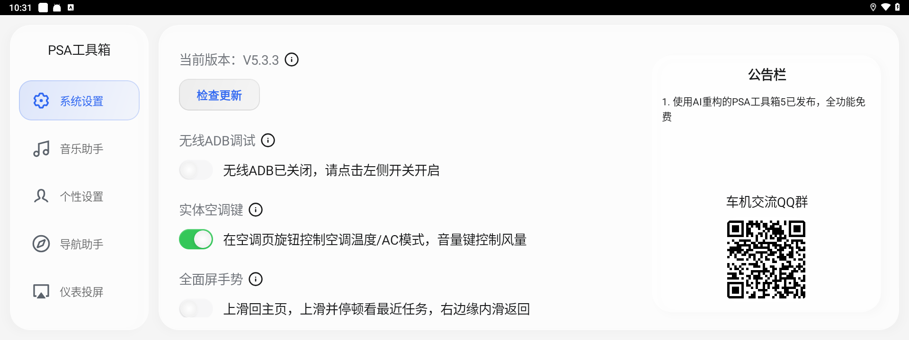

<div align="center">


# PSA 工具箱 · PSA Toolbox

**面向标致 / 雪铁龙（PSA）车机 Android 9 的系统级工具箱**

*A system-level Android toolkit for PSA/Stellantis head units (Android 9).*


[](https://github.com/band-wa/psa-toolbox/actions/workflows/ci.yml)

[功能特性](#功能特性) · [界面预览](#界面预览) · [技术栈](#技术栈) · [项目架构](#项目架构) · [核心机制](#核心机制dex-热补丁) · [快速开始](#快速开始) · [贡献](#贡献指南) · [License](#license)

</div>

---

## 简介

PSA 工具箱是一个运行在标致 / 雪铁龙车机（Android 9）上的系统级工具集合。它以 `sharedUserId=android.uid.system` 的系统应用身份运行，在 Compose 界面下提供车控、方控按键、仪表投屏、油耗记账、维护诊断等能力，并通过 **DEX 热补丁**将自研 hook 注入原厂核心件，在不修改系统分区的前提下扩展原厂行为。

项目起步于个人车机折腾，已在 PSA 车型的 Android 9 固件上日常使用；如果你使用同代车机，欢迎试用、反馈 Issue 或参与改进。

## 衍生项目

- [psa-toolbox-mapping](https://github.com/C19991221/psa-toolbox-mapping) —— 由天才大熊猫开发的扩展版本，支持全按键修改和更多功能。

## 功能特性

工具箱包含 9 个功能模块：

| 模块 | 功能 |
| --- | --- |
| **系统设置** | 无线 ADB 开关（5555）、实体空调键代理（旋钮调温 / 音量键调风量 / AC 切换）、全面屏手势、FOTA 系统更新开关、状态栏显秒、缓存自动清理与白名单、检查更新、公告栏 |
| **音乐助手** | 方控短按 / 长按自定义启动应用、上一曲 / 下一曲 / 播放暂停（自动适配 HiCar、CarLife 或按键注入）、HiCar 方控修复、CarLife 方控修复、多媒体插件安装 |
| **个性设置** | 开机欢迎语音（可网页上传自定义音频）、扫码无线安装 APK、沙发车载应用市场一键安装、原厂桌面修改（壁纸上传、卡片透明度、桌面编辑）、车机头像替换、主题 / 背景 / 字号 |
| **导航助手** | 高德车机版签名安全检测、一键激活、方控短按 / 长按绑定 |
| **仪表投屏** | 镜像投屏、独立副屏应用投屏、画面位置 / 缩放调整、开机自动投屏、右滚轮长按快捷开关 |
| **油耗账本** | 加油自动识别（VHAL 油量 / 里程）、悬浮窗金额录入、手动补录、百公里油耗、每公里油费、油箱容量设置 |
| **维护诊断** | 车况只读展示（VIN / 总里程 / 油量 / 续航 / 瞬时油耗 / 转角 / 车速 / 档位）、仅解锁后备箱、重载 U 盘、缓存清理、大文件扫描、核心件修复 |
| **专家模式** | LIST 键 360 全景开关、兼容模式、新装应用自动赋权、MTK 日志开关、开机脚本、开机自启动管理 |
| **关于软件** | 版本信息、贡献者、赞赏码 |

## 界面预览

<div align="center">
  
</div>

<div align="center">
  <sub>1920 × 720 横屏车机界面（液态玻璃风格 · 深浅色主题 · 可调字号/背景）</sub>
</div>

## 技术栈

| 分类 | 选型 |
| --- | --- |
| 平台 | Android 9（API 28）为目标设备；`minSdk 24`、`targetSdk 25`、`arm64-v8a` |
| 语言 / UI | Kotlin 1.9.25、Jetpack Compose（Material 3）、自研液态玻璃组件 |
| 架构 | 多模块（`:app` / `:core` / `:ui` / `:service` / `:hook`）、单 Activity + 9 Tab、MVI（UIState + StateFlow）、Hilt、Coroutines / Flow |
| 车控 | `android.car` `CarPropertyManager`（进程内单连接网关 + 订阅重放），编译期使用 clean-room 桩；[官方 AVD 底座](tools/android-car-boot/README.md) 注入真实 `android.car` + 系统 CarService，运行时 parent-first 覆盖桩、直接走真实链路 |
| 系统集成 | Bootclasspath 注入：把 `android.car` 客户端放进 boot class path、`com.android.car` 服务端装为系统应用。底座为 Google 官方 Android 9 userdebug AVD（替换 bootclasspath jar + 删 boot image 槽位的最小机制）；仅测试模拟器，真车勿装 |
| 热补丁 | google/smali 3.0.10（dexlib2 / baksmali）、zipflinger 零拷贝重打包、apksig v2 签名 |
| 网络 / 二维码 | OkHttp、NanoHTTPD（局域网扫码上传）、ZXing |
| 构建 | AGP 8.4.2、Gradle 8.6、JDK 17、compileSdk 34、Build-Tools 34.0.0、R8 |
| 统计 | 友盟（仅在用户同意隐私协议后初始化；AppKey 由构建注入） |

## 项目架构

```
psa-toolbox/
├── app/                              # 应用壳：Application、MainActivity、9 个 Tab 的 feature 包
│   └── src/main/
│       ├── assets/modapk/            # 原厂核心件的补丁配置（config.json）
│       ├── assets/                   # 上传页、运行时签名 keystore、提示音
│       └── res/xml/                  # 无障碍服务等配置
├── core/                             # 基础能力：util、entity、APK 下载校验、DEX 工具
├── ui/                               # Compose 主题、通用组件、通用弹窗、图标资源
├── service/                          # 常驻服务、投屏、hook 桥、安装执行、扫码上传
├── hook/                             # 注入到宿主应用的 hook.dex（AIDL 通信桥）
├── third_party/android-car-stub.jar  # android.car 编译期桩
├── tools/aosp-car-stub/              # android.car 编译期桩源码（clean-room）
├── tools/android-car-boot/           # bootclasspath 版 android.car + 系统 CarService（官方 AVD 底座，见其 README）
├── docs/                             # 架构文档、注释规范、截图
└── gradle/                           # 版本目录与 Wrapper
```

模块依赖方向：`app → core / ui / service`，`service → core / ui`，`core → hook`。详细约束与新增
代码的归属规则见 [docs/architecture.md](docs/architecture.md)。

`hook.dex` 不入库：`syncHookDex` 把它从 `hook/build/outputs/hook/` 复制到 `app/build/generated/hookAssets/hook/`，再随 assets 打进 APK。

### 进程内角色

- **PSAToolBoxService**：前台常驻服务，负责方控按键状态机、空调按键代理、投屏、油耗监控、hook 事件分发。
- **HookBridgeService**：导出给被注入宿主绑定的 AIDL 服务，维护 hook 回调与版本上报，并守护主服务。
- **ApkInstallService**：基于 `PackageInstaller` 的静默安装执行器（统一由 `ApkInstaller` 发起与等待结果）。
- **CarGateway**：全进程唯一 `android.car` 连接，3 秒看门狗重连并在重连后重放属性订阅。
- **PicHttpServerHost**：局域网扫码上传（壁纸 / 音频 / 开机脚本 / APK），单例复用、随进程常驻。

## 核心机制：DEX 热补丁

原厂核心件（如 `com.cusc.misc`、`com.android.launcher`）位于系统分区，无法直接修改。工具箱的做法是：

1. 从 `/system/app/...` 读取原厂 APK，读取 `assets/modapk/<包名>/config.json` 与内置的 `hook.dex`；
2. 只对补丁涉及的 2～5 个类做**选择性 baksmali**，在 smali 文本上执行替换，或用结构化注入在指定方法/锚点插入指令；
3. 用 DexPool 重建受影响的 dex（未改动类二进制直通），必要时整体搬迁类、`const-string/jumbo` 处理字符串索引上限；
4. 用 zipflinger **零拷贝重打包**（未改动条目原字节搬运、仅重压缩修改过的 dex），apksig 做 v2 签名；
5. 通过 `PackageInstaller` 静默安装到 `/data`，重启应用后生效。

`hook.dex` 由 `:hook` 模块通过 d8 独立构建，作为 asset 打进工具箱 APK。宿主应用启动时调用 `Hook.install()` 绑定 `HookBridgeService`，从而获得按键分发、可配置启动、壁纸/卡片透明度、版本上报等能力；未安装工具箱时自动回退原厂行为。`Hook.VERSION` / `Hook.LAUNCHER_VERSION` 用于判定补丁是否过期。

> ⚠️ 热补丁与原厂固件强相关，`config.json` 以 smali 文本匹配为主，升级车机固件后可能需要重新适配。

## 快速开始

### 环境要求

- **JDK 17**
- **Android SDK Platform 34**
- **Android SDK Build-Tools 34.0.0**（`:hook:hookDex` 使用 d8）
- 建议使用 Android Studio 或命令行 Gradle 8.6

### 构建

```bash
git clone <repo-url> psa-toolbox
cd psa-toolbox

# local.properties
# sdk.dir=/path/to/Android/sdk
# 在线功能与统计的地址 / AppKey 见下方「部署配置」

# 构建 release APK（自动构建 hook.dex 并打包为 asset）
./gradlew :app:assembleRelease

# 产物：app/build/outputs/apk/release/app-release.apk（R8 后约 2.5 MB）
```

说明：

- `android.car` 编译期桩（`third_party/android-car-stub.jar`）由 `:app` 以 `implementation` 引入，debug/release 都会打进 APK，保证非 automotive 设备不会因缺类崩溃；车机运行时优先加载系统自带的 `android.car`。`:core`、`:service` 只用 `compileOnly`。
- 构建使用仓库内的 `app/keystore.jks`（alias `bandwa`，Google 测试平台签名），与配套测试镜像一致。
- 修改 `hook/` 下代码会自动触发 `:hook:hookDex`；若手动构建，可执行 `./gradlew :hook:hookDex`。

### 部署配置

在线功能（检查更新、公告、HiCar / CarLife / 多媒体插件下载、沙发管家安装）的服务地址与友盟 AppKey 不随仓库提供，构建时通过以下任一方式注入（优先级从高到低）：

| 方式 | 示例 |
| --- | --- |
| Gradle 属性 | `./gradlew :app:assembleRelease -Ppsa.otaBase=… -Ppsa.shafaEndpoint=…` |
| 仓库根目录 `local.properties`（已 gitignore） | `psa.otaBase=…` 等，见下 |
| 环境变量 | `PSA_OTA_BASE`、`PSA_SHAFA_ENDPOINT` 等 |

| 配置项（`-P` / `local.properties`） | 环境变量 | 用途 |
| --- | --- | --- |
| `psa.otaBase` | `PSA_OTA_BASE` | 更新包、HiCar / CarLife / 多媒体插件下载 |
| `psa.infoBase` | `PSA_INFO_BASE` | 公告栏页面 |
| `psa.umengKey` | `PSA_UMENG_KEY` | 友盟统计 AppKey |
| `psa.shafaEndpoint` | `PSA_SHAFA_ENDPOINT` | 沙发管家下载地址接口 |
| `psa.donationQr` | `PSA_DONATION_QR` | 关于页赞赏码图片（绝对路径或相对仓库根目录） |

```properties
# local.properties
sdk.dir=/path/to/Android/sdk
psa.otaBase=https://ota.example.com
psa.infoBase=https://info.example.com
psa.umengKey=<your-app-key>
psa.shafaEndpoint=https://example.com/shafa/downloadurl
psa.donationQr=/path/to/your/donation.png
```

未配置时构建仍可成功：检查更新与下载入口提示「未配置…」并跳过，公告显示「暂无新公告」，沙发管家安装提示「未配置沙发管家下载地址」，友盟统计不初始化。

赞赏码默认使用仓库内置图片（`app/src/donationQr/res/drawable/qr_code.webp`）；fork 后如需换成自己的赞赏码，把图片路径配置到 `psa.donationQr` / `PSA_DONATION_QR` 即可，构建时会作为 `qr_code` 资源打包（支持 png / webp / jpg）。

### 测试

```bash
# 单元测试（core：下载/校验；service：补丁回归与窗口事件；app 暂无测试）
./gradlew :core:testDebugUnitTest :service:testDebugUnitTest :app:testDebugUnitTest

# 补丁回归测试（可选）：对真实样本 APK 跑完整的 dexlib2 重建
./gradlew :service:testDebugUnitTest -Dpatch.fixtures=/path/to/fixtures
```

`-Dpatch.fixtures` 目录结构为 `<dir>/<包名>/<版本目录>/*.apk`；未提供样本时相关用例自动跳过。

### 持续集成

仓库内置 GitHub Actions 工作流 [`.github/workflows/ci.yml`](.github/workflows/ci.yml)：push 到 `main`、提交 PR 或手动触发时，自动完成：

- 单元测试：`gradle :core:testDebugUnitTest :service:testDebugUnitTest :app:testDebugUnitTest`
- 构建校验：`:app:assembleDebug`、`:app:assembleRelease`（包含 hook.dex 构建与 R8）以及 `tools` 模块（`:tools:android-car-boot:service`）的 `assembleDebug`
- android-car-boot 构建校验：`api/build.sh` 生成 bootclasspath 客户端 jar（只校验构建链路，不产出发布件）
- 失败时上传各模块单元测试报告 artifact

CI 环境使用 JDK 17 + Android SDK 34 / Build-Tools 34.0.0；构建产物仅用于校验，不对外发布。

### 安装

```bash
adb install -r app/build/outputs/apk/release/app-release.apk
```

- 必须是**系统应用 + 平台签名**（`sharedUserId=android.uid.system`），普通设备/模拟器会安装失败。
- 首次启动需同意使用协议，并完成核心组件注入（对原厂系统件打补丁，耗时数分钟，请勿断电）。
- 建议安装完成后重启车机一次。

## 已知限制与兼容性

- 面向 **PSA 车机 Android 9（API 28）**；`targetSdk=25`、`minSdk=24`，未适配 Android 10+ 的权限与投屏差异。
- 车控属性 ID、原厂包名、补丁目标类均与固件相关：不同车型/固件需要在 `PSAToolBoxService` 常量与 `app/src/main/assets/modapk/` 中适配。
- 独立投屏依赖副屏与 Android 9 的 `am display move-stack`；镜像投屏依赖 `createVirtualDisplay`。
- 热补丁为文本匹配 + 结构化注入，固件升级后可能失效；升级后如提示“核心组件版本过低”，需要重新适配补丁。
- 性能参考（release 版，Android 9 模拟器）：常驻 PSS ≈ 47 MB，空闲 CPU ≈ 0.2% 单核；开启无障碍空调前台监控后按窗口事件驱动，无 500 ms 高频轮询。

## 贡献指南

欢迎通过 Issue 反馈问题，也欢迎代码贡献。建议按改动性质选择提交方式：

- **功能性改动与大型修改**（新增功能、重构等）：建议先 fork 本仓库，在自己的仓库中开发并验证；成熟后可以继续维护自己的分支，或整理成 PR 提交合并。
- **修复性改动**（缺陷修复、文档与小型改进）：欢迎直接提 PR，目标分支为 `main`。

无论采用哪种方式，提交前请尽量确认：

1. 提交信息遵循 `type(scope): 摘要`（如 `fix(service): 修复投屏偏移`），与现有提交风格保持一致；
2. 跑通 `./gradlew :core:testDebugUnitTest :service:testDebugUnitTest :app:testDebugUnitTest` 与 `./gradlew :app:assembleRelease`；
3. 不要提交 OTA 私有地址、AppKey 等敏感信息；
4. 代码风格与注释语言保持与现有代码一致（中文注释、4 空格缩进），注释遵循 [docs/comment-style.md](docs/comment-style.md) 的极简规范。

## 致谢

- 原厂核心件逆向与属性适配过程中参考了 AOSP、[google/smali](https://github.com/google/smali)、[apksig / zipflinger](https://android.googlesource.com/platform/tools/apksig) 等开源项目；
- [NanoHTTPD](https://github.com/NanoHttpd/nanohttpd)、[ZXing](https://github.com/zxing/zxing)、[OkHttp](https://square.github.io/okhttp/)、[Jetpack Compose](https://developer.android.com/jetpack/compose)、[Hilt](https://dagger.dev/hilt/)；
- 感谢所有参与测试、反馈问题与贡献代码的车友。

## License

本项目采用 **GNU General Public License v3.0（GPL-3.0）** 发布，完整许可证文本见 [LICENSE](LICENSE)。

Copyright (C) 2023-2026 bandwa contributors

- 你可以自由使用、修改和分发本项目；
- 衍生作品必须继续以 GPL-3.0 开源，并保留版权与许可证声明；
- 本项目按“现状”提供，不附带任何担保。

第三方依赖遵循各自许可证：AndroidX / Compose、smali、zipflinger、apksig、NanoHTTPD、OkHttp、ZXing 等为宽松许可证，可与 GPL-3.0 兼容。

## 免责声明

1. 本项目为个人兴趣项目，与 Stellantis、PSA、标致、雪铁龙及其关联公司**无任何关系**，不代表官方立场。
2. 车机系统操作存在风险，可能导致车辆功能异常、OTA 升级失败、失去保修等后果；请在充分了解风险并自行备份后使用，风险自负。
3. 请遵守当地法律法规与厂家的用户条款；本项目不鼓励、也不提供任何绕过授权或破解付费功能的能力。
4. 本项目按“现状”提供，不对任何直接或间接损失承担责任。
